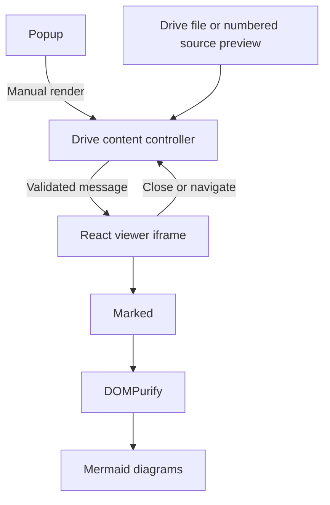

# Drive Markdown Reader

A Chrome Manifest V3 extension built with React 19, TypeScript, and Vite 8. Read Markdown and render Mermaid diagrams directly in Google Drive.

## Contents

- [Current features](#current-features)
- [Install from GitHub Releases](#install-from-github-releases)
- [Build from source](#build-from-source)
- [Read Markdown in Drive](#read-markdown-in-drive)
- [Architecture](#architecture)
- [Tech stack](#tech-stack)
- [Development commands](#development-commands)
- [Permissions and data](#permissions-and-data)
- [Troubleshooting](#troubleshooting)
- [Verification](#verification)
- [CI and delivery](#ci-and-delivery)
- [Documentation](#documentation)
- [Author](#author)
- [Contributing](#contributing)
- [License](#license)

## Current features

- **Drive integration:** open `.md` and `.markdown` files in an extension viewer. The viewer can open automatically when the extension detects a Markdown preview.
- **Markdown rendering:** read headings, lists, tables, links, and styled code blocks. The reader uses Marked and sanitizes its HTML output with DOMPurify.
- **Mermaid diagrams:** render flowcharts, sequence diagrams, and other supported Mermaid diagrams. Switch between the diagram and its source with **Graph / Code**.
- **Reading controls:** switch between light and dark themes, zoom from 50% to 250%, and move between nearby files when Drive exposes the necessary file IDs.
- **Isolated viewer:** the React interface runs in an extension-origin iframe. Theme, zoom, and Graph / Code preferences persist locally.

Drive's native **Preview** can format regular Markdown. Use the extension when you need Mermaid diagrams or its reading controls.

## Install from GitHub Releases

Use desktop Chrome. The build targets Chrome 120. Check [GitHub Releases](https://github.com/tlavu2004/drive-markdown-reader/releases) for published packages.

1. Open [GitHub Releases](https://github.com/tlavu2004/drive-markdown-reader/releases) and select a published version. If none is available, follow [Build from source](#build-from-source).
2. Download `drive-markdown-reader.zip` under **Assets**. GitHub's **Source code** archives contain the project source.
3. Extract the ZIP into a folder you plan to keep. The folder must directly contain `manifest.json`.
4. Open `chrome://extensions`, enable **Developer mode**, click **Load unpacked**, and select that folder.
5. Open the extension from Chrome's extensions menu. Pin it to the toolbar if desired.

For checksum verification, manual updates, and CI review builds, see [Installation and troubleshooting](docs/guides/INSTALLATION.md).

## Build from source

Use Node.js 24.15 or later in the 24.x line, matching CI.

```powershell
git clone https://github.com/tlavu2004/drive-markdown-reader.git
cd drive-markdown-reader
npm ci
npm run build
npm run verify:extension
```

In `chrome://extensions`, enable **Developer mode**, click **Load unpacked**, and select the generated `dist/` directory. After rebuilding, reload the extension and refresh the Drive tab.

## Read Markdown in Drive

1. Open a Markdown file in Google Drive. When using Drive's native viewer, select **Markdown** to expose the source.
2. If the extension viewer does not open automatically, click the extension icon and choose **Render Markdown**.
3. Use **Graph / Code** for Mermaid and **Dark / Light** for theme. Use the minus, percentage, and plus buttons to zoom out, reset to 100%, or zoom in. **Previous / Next** depends on the nearby files available in Drive's page.
4. Click **Close** to return to Drive's preview.

Use a fenced block labeled `mermaid` for diagrams. Relative images and links may fail to resolve because the extension viewer has a different document URL.

Screenshots are pending. See the [capture guide](docs/guides/SCREENSHOTS.md) for the two views and filenames.

## Architecture

The popup requests a manual render and injects the content script when needed. The content script identifies the active file, fetches Markdown from Drive or reconstructs numbered source lines in the page and accessible same-origin frames, then sends it to the viewer. The content controller handles automatic opening, request cancellation, and viewer teardown.



See [Architecture and source layout](docs/guides/ARCHITECTURE.md) for source extraction, rendering, and the viewer lifecycle.

### Directory layout

Source files are grouped by extension surface rather than file extension. A popup or viewer keeps its HTML, CSS and controller together; external runtime libraries and their licenses are kept outside application source.

```text
drive-markdown-reader/
├── manifest.json  # Build manifest template
├── vite.config.ts
├── tsconfig.json
├── src/
│   ├── content/
│   │   ├── drive.ts
│   │   └── index.ts
│   ├── popup/
│   │   ├── index.html
│   │   ├── popup.css
│   │   └── popup.ts
│   ├── viewer/
│   │   ├── index.html
│   │   ├── main.tsx
│   │   ├── app/
│   │   │   ├── mount.tsx
│   │   │   ├── Viewer.tsx
│   │   │   └── viewer.css
│   │   ├── components/
│   │   │   ├── Toolbar.tsx
│   │   │   ├── ViewerStatus.tsx
│   │   │   └── MarkdownContent.tsx
│   │   ├── hooks/
│   │   │   └── usePreferences.ts
│   │   ├── rendering/
│   │   │   ├── RenderedMarkdown.tsx
│   │   │   └── createMarkdownRenderer.ts
│   │   └── messaging/
│   │       ├── protocol.ts
│   │       └── useViewerMessages.ts
│   ├── shared/  # Typed messages, DOM utilities and runtime paths
│   └── types/vendor.d.ts  # Contracts for the existing vendor globals
├── vendor/
│   ├── dompurify/purify.min.js
│   ├── marked/marked.min.js
│   └── mermaid/mermaid.min.js
├── licenses/
│   ├── DOMPurify.LICENSE
│   ├── React.LICENSE
│   ├── ReactDOM.LICENSE
│   └── Scheduler.LICENSE
├── scripts/
│   ├── build.ts
│   ├── vendor.ts
│   ├── verify-extension.ts
│   └── package-extension.py
├── tests/
├── docs/
│   ├── guides/
│   └── releases/
├── .github/workflows/
└── dist/  # Generated extension; ignored by Git
```

## Tech stack

| Area | Technology |
| --- | --- |
| Extension platform | Chrome Manifest V3, content script, extension-origin iframe |
| Viewer | React 19, TypeScript, CSS |
| Popup and Drive integration | TypeScript, Chrome tabs and scripting APIs |
| Markdown and diagrams | Marked, DOMPurify, Mermaid |
| Build and development | Vite 8, Node.js 24, npm |
| Tests | Node test runner, jsdom, esbuild, React `act` |
| Delivery | GitHub Actions, versioned GitHub Releases, ZIP and SHA-256 |

Popup and viewer build as ES modules. The content script builds as a classic bundle for manifest loading and manual injection. Vite emits source maps. Runtime libraries are packaged locally.

## Development commands

| Command | Purpose |
| --- | --- |
| `npm run dev` | Rebuild on changes. Reload the extension and refresh Drive to see updates. |
| `npm run typecheck` | Check types in the app, build configuration, scripts, and tests. |
| `npm run build` | Typecheck and build the extension into `dist/`. |
| `npm test` | Build and run regression tests. |
| `npm run verify:extension` | Check an existing build's manifest, assets, bundled scripts, and licenses. |
| `npm run check` | Run the build, regression tests, and extension checks. |
| `npm run vendor` | Refresh the vendored DOMPurify bundle and third-party license files. |

## Permissions and data

The content script runs on `drive.google.com`. **activeTab** lets the popup act on the active tab, and **scripting** lets it inject the content script when needed. The extension reads the active preview or requests Markdown from Google Drive. It processes Markdown in the browser and stores reading preferences locally. Images with remote URLs can trigger browser requests to their hosts. See [privacy and data handling](docs/guides/PRIVACY.md).

## Troubleshooting

| Symptom | What to check |
| --- | --- |
| Chrome cannot load the extension | Select the extracted folder containing the manifest or the generated `dist/`. |
| The reader cannot find Markdown | Select Drive's **Markdown** source tab and choose **Render Markdown**. |
| Mermaid appears as code | Select **Graph** and check the `mermaid` fence. |

See [installation and troubleshooting](docs/guides/INSTALLATION.md#troubleshooting).

## Verification

```powershell
npm ci
npm run check
```

The automated tests use jsdom with simulated Drive responses and a Mermaid stub. Before publishing, install the ZIP in Chrome and follow the [browser verification checklist](docs/guides/TESTING.md#chrome-smoke-checks).

## CI and delivery

GitHub Actions runs the shared verification workflow for PRs targeting `main`, pushes to `main`, and manual runs. The `drive-markdown-reader` Actions artifact contains `drive-markdown-reader.zip` and `drive-markdown-reader.zip.sha256`. A matching version tag on a commit from `main` triggers the same checks. The publish job downloads and verifies that run's archive and uploads it with the versioned release notes. See [releasing](docs/guides/RELEASING.md).

## Documentation

- [Installation and troubleshooting](docs/guides/INSTALLATION.md)
- [Architecture and source layout](docs/guides/ARCHITECTURE.md)
- [Testing and delivery](docs/guides/TESTING.md)
- [Screenshots to capture](docs/guides/SCREENSHOTS.md)
- [Privacy and local data handling](docs/guides/PRIVACY.md)
- [Release procedure](docs/guides/RELEASING.md)
- [Changelog](CHANGELOG.md)
- [v1.0.0 release notes](docs/releases/V1.0.0.md)

## Author

Developed and maintained by **Trương Lê Anh Vũ** ([@tlavu2004](https://github.com/tlavu2004)).

## Contributing

Bug reports, documentation improvements, and focused code changes are welcome. See the [contribution guide](.github/CONTRIBUTING.md) for setup, branch conventions, and verification.

Follow the [Code of Conduct](CODE_OF_CONDUCT.md). Report vulnerabilities privately using the [security policy](.github/SECURITY.md). See the [accessibility statement](ACCESSIBILITY.md) for current support, limitations, and how to report barriers.

## License

The project uses the [MIT License](LICENSE). Release packages include the project license and [third-party notices](licenses/README.md).
