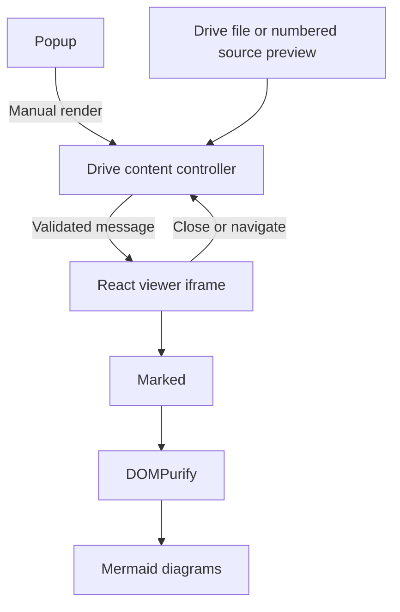

# Drive Markdown Reader

A Chrome Manifest V3 extension built with React 19, TypeScript, and Vite 8. Read Markdown and render Mermaid diagrams directly in Google Drive.

## Contents

- [Current features](#current-features)
- [Install from GitHub Releases](#install-from-github-releases)
- [Build from source](#build-from-source)
- [Read Markdown in Drive](#read-markdown-in-drive)
- [Architecture](#architecture)
- [Tech stack](#tech-stack)
- [Development commands](#development-commands)
- [Permissions and data](#permissions-and-data)
- [Troubleshooting](#troubleshooting)
- [Verification](#verification)
- [CI and delivery](#ci-and-delivery)
- [Documentation](#documentation)
- [Author](#author)
- [Contributing](#contributing)
- [License](#license)

## Current features

- **Drive integration:** open `.md` and `.markdown` files in an extension viewer. The viewer can open automatically when the extension detects a Markdown preview.
- **Markdown rendering:** read headings, lists, tables, links, and styled code blocks. The reader uses Marked and sanitizes its HTML output with DOMPurify.
- **Mermaid diagrams:** render flowcharts, sequence diagrams, and other supported Mermaid diagrams. Switch between the diagram and its source with **Graph / Code**.
- **Reading controls:** switch between light and dark themes, zoom from 50% to 250%, and move between nearby files when Drive exposes the necessary file IDs.
- **Isolated viewer:** the React interface runs in an extension-origin iframe. Theme, zoom, and Graph / Code preferences persist locally.

Drive's native **Preview** can format regular Markdown. Use the extension when you need Mermaid diagrams or its reading controls.

## Install from GitHub Releases

Use desktop Chrome. Installation from a release requires no local build.

1. Open [GitHub Releases](https://github.com/tlavu2004/drive-markdown-reader/releases) and select a published version. If none is available, follow [Build from source](#build-from-source).
2. Download `drive-markdown-reader.zip` under **Assets**. GitHub's **Source code** archives contain the project source.
3. Extract the ZIP into a folder you plan to keep. The folder must directly contain `manifest.json`.
4. Open `chrome://extensions`, enable **Developer mode**, click **Load unpacked**, and select that folder.
5. Open the extension from Chrome's extensions menu. Pin it to the toolbar if desired.

To update, extract the new package over the same directory, click **Reload** on the extension card, and refresh any open Drive tabs. ZIP installations require manual updates.

Download the accompanying `.sha256` file to verify the ZIP. On Windows, run `Get-FileHash ./drive-markdown-reader.zip -Algorithm SHA256` and compare the hash. Before a release, reviewers can extract the **drive-markdown-reader** artifact from a successful GitHub Actions run and install the ZIP inside it. See the [installation guide](docs/guides/INSTALLATION.md).

## Build from source

Use Node.js 24.15 or later in the 24.x line, matching CI.

```powershell
git clone https://github.com/tlavu2004/drive-markdown-reader.git
cd drive-markdown-reader
npm ci
npm run build
npm run verify:extension
```

In `chrome://extensions`, enable **Developer mode**, click **Load unpacked**, and select the generated `dist/` directory. After rebuilding, reload the extension and refresh the Drive tab.

## Read Markdown in Drive

1. Open a Markdown file in Google Drive. When using Drive's native viewer, select **Markdown** to expose the source.
2. If the extension viewer does not open automatically, click the extension icon and choose **Render Markdown**.
3. Use **Graph / Code** for Mermaid, **Dark / Light** for theme, and **− / 100% / +** to adjust or reset zoom. **Previous / Next** depends on the nearby files available in Drive's page.
4. Click **Close** to return to Drive's preview.

Use a fenced block labeled `mermaid` for diagrams. Relative images and links may fail to resolve because the extension viewer has a different document URL.

## Architecture

The popup requests a manual render and injects the content script when needed. The content script identifies the active file, fetches Markdown from Drive or reconstructs numbered source lines in the page and accessible same-origin frames, then sends it to the viewer. The content controller handles automatic opening, request cancellation, and viewer teardown.



The message bridge validates window, origin, and payload. The viewer registers its listener before announcing readiness. React manages the toolbar, preferences, and load/error states, while the renderer owns the Markdown DOM. Each renderer uses its own Marked instance and serializes Mermaid work to avoid overlapping diagram renders. See [architecture and source layout](docs/guides/ARCHITECTURE.md).

### Directory layout

Source files are grouped by extension surface rather than file extension. A popup or viewer keeps its HTML, CSS and controller together; external runtime libraries and their licenses are kept outside application source.

```text
drive-markdown-reader/
├── manifest.json  # Build manifest template
├── vite.config.ts
├── tsconfig.json
├── src/
│   ├── content/
│   │   ├── drive.ts
│   │   └── index.ts
│   ├── popup/
│   │   ├── index.html
│   │   ├── popup.css
│   │   └── popup.ts
│   ├── viewer/
│   │   ├── index.html
│   │   ├── main.tsx
│   │   ├── app/
│   │   │   ├── mount.tsx
│   │   │   ├── Viewer.tsx
│   │   │   └── viewer.css
│   │   ├── components/
│   │   │   ├── Toolbar.tsx
│   │   │   ├── ViewerStatus.tsx
│   │   │   └── MarkdownContent.tsx
│   │   ├── hooks/
│   │   │   └── usePreferences.ts
│   │   ├── rendering/
│   │   │   ├── RenderedMarkdown.tsx
│   │   │   └── createMarkdownRenderer.ts
│   │   └── messaging/
│   │       ├── protocol.ts
│   │       └── useViewerMessages.ts
│   ├── shared/  # Typed messages, DOM utilities and runtime paths
│   └── types/vendor.d.ts  # Contracts for the existing vendor globals
├── vendor/
│   ├── dompurify/purify.min.js
│   ├── marked/marked.min.js
│   └── mermaid/mermaid.min.js
├── licenses/
│   ├── DOMPurify.LICENSE
│   ├── React.LICENSE
│   ├── ReactDOM.LICENSE
│   └── Scheduler.LICENSE
├── scripts/
│   ├── build.ts
│   ├── vendor.ts
│   ├── verify-extension.ts
│   └── package-extension.py
├── tests/
├── .github/workflows/
└── dist/  # Generated extension; ignored by Git
```

## Tech stack

| Area | Technology |
| --- | --- |
| Extension platform | Chrome Manifest V3, content script, extension-origin iframe |
| Viewer | React 19, TypeScript, CSS |
| Popup and Drive integration | TypeScript, Chrome tabs and scripting APIs |
| Markdown and diagrams | Marked, DOMPurify, Mermaid |
| Build and development | Vite 8, Node.js 24, npm |
| Tests | Node test runner, jsdom, esbuild, React `act` |
| Delivery | GitHub Actions, versioned GitHub Releases, ZIP and SHA-256 |

Popup and viewer build as ES modules. The content script builds as a classic bundle for manifest loading and manual injection. Vite emits source maps. The React viewer entry is approximately 225 KB minified or 70 KB gzip. Runtime libraries are packaged locally.

## Development commands

| Command | Purpose |
| --- | --- |
| `npm run dev` | Rebuild on changes. Reload the extension and refresh Drive to see updates. |
| `npm run typecheck` | Check types in the app, build configuration, scripts, and tests. |
| `npm run build` | Typecheck and build the extension into `dist/`. |
| `npm test` | Build and run regression tests. |
| `npm run verify:extension` | Check an existing build's manifest, assets, bundled scripts, and licenses. |
| `npm run check` | Run the build, regression tests, and extension checks. |
| `npm run vendor` | Refresh the vendored DOMPurify bundle and third-party license files. |

## Permissions and data

The content script runs on `drive.google.com`. **activeTab** lets the popup act on the active tab, and **scripting** lets it inject the content script when needed. The extension reads the active preview or requests Markdown from Google Drive. It processes Markdown in the browser and stores reading preferences locally. Images with remote URLs can trigger browser requests to their hosts. See [privacy and data handling](docs/guides/PRIVACY.md).

## Troubleshooting

| Symptom | What to check |
| --- | --- |
| Chrome cannot find the manifest or reports a TypeScript MIME error | Load the extracted release folder containing `manifest.json` or the source build's `dist/`. |
| The extension cannot find Markdown | Close the extension viewer, select Drive's **Markdown** source tab, then click **Render Markdown**. |
| A diagram appears as code | Select **Graph** and check that the fence is labeled `mermaid`. |
| An image or link is missing | Try an accessible absolute URL. |
| **Previous / Next** is unavailable | Navigation depends on file IDs and the items currently present in Drive's page. |
| An update seems unchanged | Check the loaded directory, reload the extension in Chrome, and refresh Drive. |

See [installation and troubleshooting](docs/guides/INSTALLATION.md#troubleshooting).

## Verification

```powershell
npm ci
npm run check
```

The test suite covers the built popup and viewer, Drive source extraction, message validation, stale requests, sanitization, theme changes, and React cleanup. Drive responses and Mermaid rendering are simulated. Test authenticated downloads, iframe integration, and real Mermaid layout in Chrome before releasing.

1. Open a standalone Drive file and a folder preview. Try short and empty Markdown files.
2. Close the viewer, interact with Drive, and reopen it from the popup.
3. Switch files or close while loading and confirm stale results stay out of view.
4. Check that a denied download shows a readable error and remains closable.
5. Try valid and invalid Mermaid fences, theme changes, zoom, and **Graph / Code**.
6. Try **Previous / Next** in the Drive list and grid.

See [testing and delivery](docs/guides/TESTING.md).

## CI and delivery

GitHub Actions runs the shared verification workflow for PRs targeting `main`, pushes to `main`, and manual runs. It uploads `drive-markdown-reader.zip` and its SHA-256 checksum. A matching version tag on a commit from `main` triggers the same checks. The publish job downloads and verifies that run's archive and uploads it with the versioned release notes. See [releasing](docs/guides/RELEASING.md).

## Documentation

- [Installation and troubleshooting](docs/guides/INSTALLATION.md)
- [Architecture and source layout](docs/guides/ARCHITECTURE.md)
- [Testing and delivery](docs/guides/TESTING.md)
- [Privacy and local data handling](docs/guides/PRIVACY.md)
- [Release procedure](docs/guides/RELEASING.md)
- [Changelog](CHANGELOG.md)
- [v1.0.0 release notes](docs/releases/V1.0.0.md)

## Author

Developed and maintained by **Trương Lê Anh Vũ** ([GitHub profile](https://github.com/tlavu2004)).

## Contributing

Bug reports, documentation improvements, and focused code changes are welcome. See the [contribution guide](.github/CONTRIBUTING.md) for setup, branch conventions, and verification.

Follow the [Code of Conduct](CODE_OF_CONDUCT.md). Report vulnerabilities privately using the [security policy](.github/SECURITY.md). See the [accessibility statement](ACCESSIBILITY.md) for current support, limitations, and how to report barriers.

## License

The project uses the [MIT License](LICENSE). Release packages include the project license and [third-party notices](licenses/README.md).
